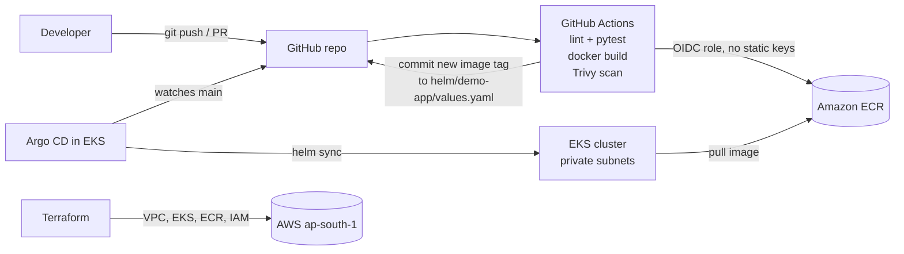

# GitOps CI/CD Platform on AWS EKS

End-to-end delivery platform: **Terraform** provisions AWS (VPC, EKS, ECR, IAM/OIDC),
**GitHub Actions** tests, scans and pushes container images, and **Argo CD** deploys them
to Kubernetes from Git using a **Helm** chart. Git is the single source of truth for
what runs in the cluster.


## Architecture



**Flow of a change:**
1. A PR touching `app/` runs lint, unit tests, Docker build and a Trivy image scan.
2. On merge to `main`, the image is pushed to ECR tagged with the short commit SHA
   (tags are immutable, so every deployment is traceable to a commit).
3. CI commits the new tag into `helm/demo-app/values.yaml`.
4. Argo CD detects the commit and rolls the Deployment (`maxUnavailable: 0` → zero downtime).
5. Rollback = `git revert` of the tag-bump commit. Argo CD syncs back to the previous image.

## Repository layout

| Path | What it is |
|------|------------|
| `app/` | Flask service with `/healthz`, `/readyz`, `/metrics` (Prometheus), unit tests, multi-stage non-root Dockerfile |
| `terraform/` | VPC (2 AZs, public + private subnets, NAT), EKS + managed node group, ECR with scan-on-push and lifecycle policy, GitHub OIDC provider + least-privilege CI role |
| `helm/demo-app/` | Deployment, Service, HPA, PodDisruptionBudget; probes, resource limits, read-only root FS |
| `argocd/demo-app.yaml` | Argo CD `Application` with automated sync, prune and self-heal |
| `.github/workflows/` | `ci.yml` (app pipeline) and `terraform.yml` (fmt, validate, config scan) |
| `docs/bootstrap-state.md` | S3 + DynamoDB remote state setup |

## Run it

### 0. Run the app locally (no cloud needed)
```bash
cd app
python -m venv .venv && source .venv/bin/activate   # Windows: .venv\Scripts\activate
pip install -r requirements-dev.txt
pytest -q
python app.py            # http://localhost:8080
```

### 1. Provision AWS
Prerequisites: AWS CLI configured, Terraform >= 1.6, kubectl, helm.
```bash
cd terraform
cp terraform.tfvars.example terraform.tfvars
terraform init
terraform plan
terraform apply
$(terraform output -raw configure_kubectl)   # point kubectl at the new cluster
kubectl get nodes
```

### 2. Connect GitHub Actions to AWS
Add a repo secret `AWS_ROLE_ARN` = `terraform output -raw github_ci_role_arn`.
Then update the `repository:` line in `helm/demo-app/values.yaml` with
`terraform output -raw ecr_repository_url` (CI keeps it updated after the first run).

### 3. Install Argo CD and register the app
```bash
kubectl create namespace argocd
kubectl apply -n argocd -f https://raw.githubusercontent.com/argoproj/argo-cd/stable/manifests/install.yaml
kubectl apply -f argocd/demo-app.yaml

# UI: https://localhost:8443  (user: admin)
kubectl -n argocd port-forward svc/argocd-server 8443:443
kubectl -n argocd get secret argocd-initial-admin-secret -o jsonpath="{.data.password}" | base64 -d
```

### 4. Ship a change
Edit `app/app.py`, open a PR, merge. Watch the Actions run, then the Argo CD UI.
```bash
kubectl -n demo get pods -w
kubectl -n demo port-forward svc/demo-app 8080:80 && curl localhost:8080
```

### 5. Tear down (avoid charges)
```bash
kubectl delete -f argocd/demo-app.yaml
cd terraform && terraform destroy
```
**Cost note:** the EKS control plane, NAT gateway and 2 × t3.medium nodes are billed hourly.
Create, demo, screenshot and destroy in the same session.

## Design decisions

| Decision | Why | Trade-off |
|----------|-----|-----------|
| **Pull-based GitOps (Argo CD)** instead of `kubectl apply` from CI | CI never holds cluster credentials; cluster state is auditable in Git; self-heal reverts manual drift | One more component to run and secure |
| **GitHub OIDC → IAM role** | No long-lived AWS keys in GitHub; trust is scoped to `main` of one repo | Initial IAM setup is more involved |
| **Immutable image tags = commit SHA** | Every running pod maps to an exact commit; rollback is a Git revert | Tag bump commits add noise to history |
| **Scan before push (Trivy)** | Vulnerable images never reach the registry | Builds fail on new CVEs until base image is patched |
| **Private subnets for nodes, single NAT** | Nodes are not internet-reachable; one NAT keeps demo cost low | Single NAT is an AZ-level single point of failure (use one per AZ in prod) |
| **`maxUnavailable: 0` + readiness probe + PDB** | Rolling updates and node drains never drop serving capacity | Rollouts need spare capacity for the surge pod |
| **HPA on CPU** | Scales 2→5 replicas under load | CPU is a proxy; request-rate based scaling would need KEDA / custom metrics |

## Troubleshooting

| Symptom | Check |
|---------|-------|
| Pods `ImagePullBackOff` | `kubectl -n demo describe pod <pod>`; does the tag exist in ECR? Node role has ECR read via the EKS module defaults |
| Argo CD app `OutOfSync` but not syncing | `kubectl -n argocd get application demo-app -o yaml` → `status.conditions`; repo URL / path / branch correct? |
| CI fails at "Configure AWS credentials" | `AWS_ROLE_ARN` secret set? Running on `main`? Trust policy `sub` must match `repo:<owner>/<repo>:ref:refs/heads/main` |
| Pods `CrashLoopBackOff` | `kubectl -n demo logs <pod> --previous`; read-only root FS needs writes to go to `/tmp` |
| HPA shows `<unknown>` targets | metrics-server not installed: `kubectl apply -f https://github.com/kubernetes-sigs/metrics-server/releases/latest/download/components.yaml` |

## Roadmap
- [ ] AWS Load Balancer Controller + Ingress with TLS (ACM)
- [ ] Separate `dev` / `prod` value files with Argo CD ApplicationSet
- [ ] Argo Rollouts canary with Prometheus analysis
- [ ] External Secrets Operator + AWS Secrets Manager
- [ ] `terraform plan` on PRs with the plan posted as a PR comment
